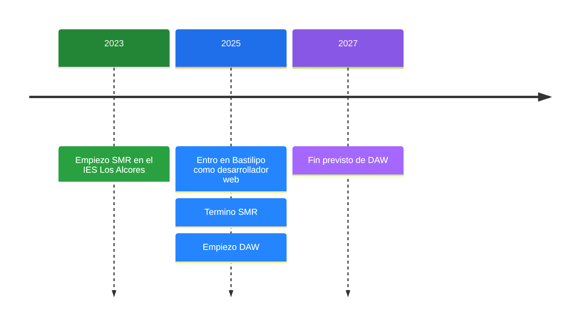

  

  <a href="#sobre-mí">Sobre mí</a> &nbsp;/&nbsp;
  <a href="#stack">Stack</a> &nbsp;/&nbsp;
  <a href="#experiencia">Experiencia</a> &nbsp;/&nbsp;
  <a href="#proyectos">Proyectos</a> &nbsp;/&nbsp;
  <a href="#trayectoria">Trayectoria</a> &nbsp;/&nbsp;
  <a href="#contacto">Contacto</a>

## Sobre mí

Soy de Sevilla. Terminé el grado medio de **Sistemas Microinformáticos y Redes** en 2025 y ahora estoy con el superior de **Desarrollo de Aplicaciones Web** en el IES Los Alcores, que compagino con mi trabajo como desarrollador web en **Bastilipo**.

En el trabajo me dedico sobre todo a tiendas online con **WordPress** y **PrestaShop**: las monto, las mantengo y me encargo de lo que hay alrededor, desde el hosting y los dominios hasta Analytics y las campañas de Ads. En clase estoy con **Java, Spring Boot y Angular**, y aquí voy subiendo lo que hago.

## Stack

Pasa el ratón por encima de los iconos para ver qué es cada uno. Los lenguajes llevan a mis repositorios en ese lenguaje.

| Área | Herramientas |
|:--|:--|
| **Backend** |       |
| **Frontend** |      |
| **CMS y tiendas** |    |
| **Marketing** |      |
| **Sistemas** |        |
| **Día a día** |     |

<b>Redes y sistemas</b> (lo que traigo de SMR)

 

- Windows 10/11 y Windows Server 2019, Ubuntu, Debian y Kali
- Active Directory, DNS, DHCP y FTP
- Gestión de usuarios y escritorio remoto
- Montaje, mantenimiento y reparación de equipos

## Experiencia

**Desarrollador web en [Bastilipo](https://bastilipo.es)** · desde marzo de 2025

Me encargo de mantener y actualizar la web corporativa y la tienda online, de las bases de datos y de que todo cargue rápido.

Además he desarrollado estas tiendas desde cero. Puedes abrirlas:

  
  
  
  

<b>Qué hice en las tiendas</b>

 

- Desarrollo completo con WordPress o PrestaShop, con bastante personalización
- Gestión de hosting, dominios y bases de datos
- Medición con Google Analytics y Tag Manager
- Campañas en Google Ads y trabajo de SEO

## Proyectos

  
  
  
  

<b>Más prácticas de clase</b>

 

| Repositorio | Qué es |
|:--|:--|
| [Practica2JS](https://github.com/Nicolasgm07/Practica2JS) | Ejercicios de JavaScript con el BOM |
| [ActividadEvaluable](https://github.com/Nicolasgm07/ActividadEvaluable) | Actividad evaluable de JavaScript |
| [UD1-proyecto-js](https://github.com/Nicolasgm07/UD1-proyecto-js) | Proyecto de la primera unidad de JavaScript |
| [Actividad1](https://github.com/Nicolasgm07/Actividad1) | Primera actividad en Java |

## Trayectoria

## Actividad

  
  

  <picture>
    <source media="(prefers-color-scheme: dark)" srcset="https://raw.githubusercontent.com/Nicolasgm07/Nicolasgm07/output/github-snake-dark.svg" />
    <source media="(prefers-color-scheme: light)" srcset="https://raw.githubusercontent.com/Nicolasgm07/Nicolasgm07/output/github-snake.svg" />
    
  </picture>

## Contacto

  
  

  

