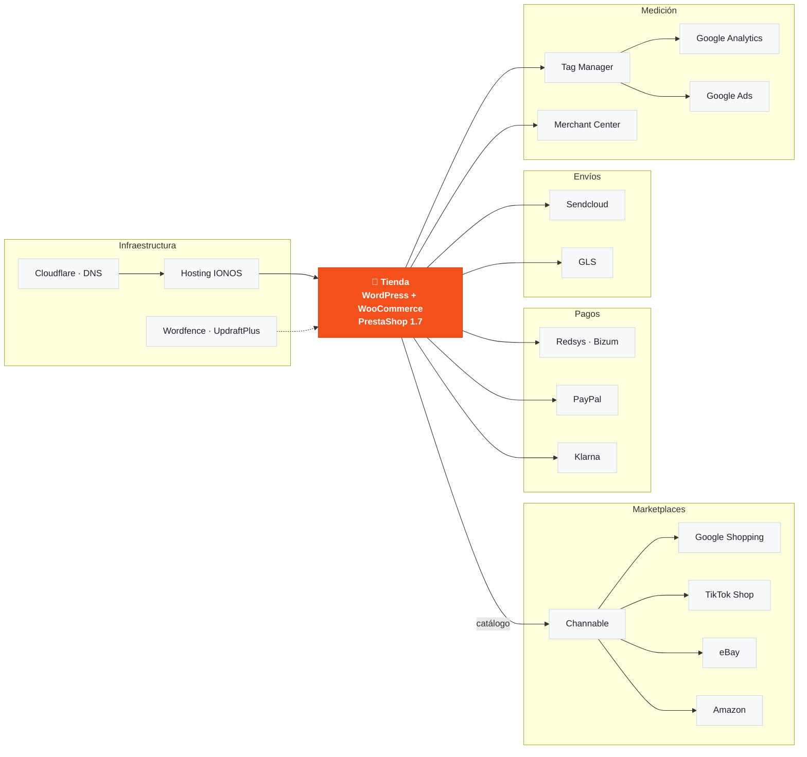
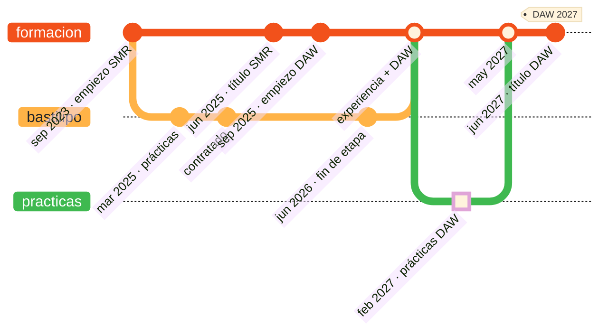

<a name="top"></a>

<p align="center">
<picture><source media="(prefers-color-scheme: dark)" srcset="https://raw.githubusercontent.com/Nicolasgm07/Nicolasgm07/main/assets/hero/hero-dark.svg"><source media="(prefers-color-scheme: light)" srcset="https://raw.githubusercontent.com/Nicolasgm07/Nicolasgm07/main/assets/hero/hero-light.svg"></picture>
</p>

<p align="center">
  <a href="#sobre-mi"><picture><source media="(prefers-color-scheme: dark)" srcset="https://raw.githubusercontent.com/Nicolasgm07/Nicolasgm07/main/assets/nav/sobre-mi-dark.svg"><source media="(prefers-color-scheme: light)" srcset="https://raw.githubusercontent.com/Nicolasgm07/Nicolasgm07/main/assets/nav/sobre-mi-light.svg"></picture></a>
  <a href="#stack"><picture><source media="(prefers-color-scheme: dark)" srcset="https://raw.githubusercontent.com/Nicolasgm07/Nicolasgm07/main/assets/nav/stack-dark.svg"><source media="(prefers-color-scheme: light)" srcset="https://raw.githubusercontent.com/Nicolasgm07/Nicolasgm07/main/assets/nav/stack-light.svg"></picture></a>
  <a href="#experiencia"><picture><source media="(prefers-color-scheme: dark)" srcset="https://raw.githubusercontent.com/Nicolasgm07/Nicolasgm07/main/assets/nav/experiencia-dark.svg"><source media="(prefers-color-scheme: light)" srcset="https://raw.githubusercontent.com/Nicolasgm07/Nicolasgm07/main/assets/nav/experiencia-light.svg"></picture></a>
  <a href="#portfolio"><picture><source media="(prefers-color-scheme: dark)" srcset="https://raw.githubusercontent.com/Nicolasgm07/Nicolasgm07/main/assets/nav/portfolio-dark.svg"><source media="(prefers-color-scheme: light)" srcset="https://raw.githubusercontent.com/Nicolasgm07/Nicolasgm07/main/assets/nav/portfolio-light.svg"></picture></a>
  <a href="#proyectos"><picture><source media="(prefers-color-scheme: dark)" srcset="https://raw.githubusercontent.com/Nicolasgm07/Nicolasgm07/main/assets/nav/proyectos-dark.svg"><source media="(prefers-color-scheme: light)" srcset="https://raw.githubusercontent.com/Nicolasgm07/Nicolasgm07/main/assets/nav/proyectos-light.svg"></picture></a>
  <a href="#formacion"><picture><source media="(prefers-color-scheme: dark)" srcset="https://raw.githubusercontent.com/Nicolasgm07/Nicolasgm07/main/assets/nav/formacion-dark.svg"><source media="(prefers-color-scheme: light)" srcset="https://raw.githubusercontent.com/Nicolasgm07/Nicolasgm07/main/assets/nav/formacion-light.svg"></picture></a>
  <a href="#actividad"><picture><source media="(prefers-color-scheme: dark)" srcset="https://raw.githubusercontent.com/Nicolasgm07/Nicolasgm07/main/assets/nav/actividad-dark.svg"><source media="(prefers-color-scheme: light)" srcset="https://raw.githubusercontent.com/Nicolasgm07/Nicolasgm07/main/assets/nav/actividad-light.svg"></picture></a>
  <a href="#juega"><picture><source media="(prefers-color-scheme: dark)" srcset="https://raw.githubusercontent.com/Nicolasgm07/Nicolasgm07/main/assets/nav/juega-dark.svg"><source media="(prefers-color-scheme: light)" srcset="https://raw.githubusercontent.com/Nicolasgm07/Nicolasgm07/main/assets/nav/juega-light.svg"></picture></a>
  <a href="#contacto"><picture><source media="(prefers-color-scheme: dark)" srcset="https://raw.githubusercontent.com/Nicolasgm07/Nicolasgm07/main/assets/nav/contacto-dark.svg"><source media="(prefers-color-scheme: light)" srcset="https://raw.githubusercontent.com/Nicolasgm07/Nicolasgm07/main/assets/nav/contacto-light.svg"></picture></a>
</p>

<p align="center"><b>¿Qué te trae por aquí?</b> Elige tu camino 👇</p>

<details>
<summary><b>🧑‍💼 Busco a alguien para prácticas</b></summary>
<br>

¡Perfecto, yo también te estoy buscando! En corto:

- **Cuándo:** prácticas de empresa de 2.º de DAW, **de febrero a mayo de 2027**.
- **Experiencia real:** 1 año y 4 meses en Bastilipo como desarrollador web y e-commerce. Entré con las prácticas del SMR y me contrataron por mi rendimiento.
- **Lo que aporto desde el primer día:** WordPress, WooCommerce, PrestaShop, PHP y SQL, y todo lo que rodea a una tienda online: pagos, envíos, marketplaces, analítica y hosting.
- **Lo que estoy aprendiendo en DAW:** Angular, Java y Spring Boot.

👉 [Experiencia](#experiencia) · [Portfolio](#portfolio) · [Escríbeme](#contacto)

</details>

<details>
<summary><b>👨‍💻 Soy developer y quiero ver código</b></summary>
<br>

- **Proyecto estrella:** [app-lol](https://github.com/Nicolasgm07/app-lol) (Angular 21 con SSR) consumiendo mi API [league_of_legends](https://github.com/Nicolasgm07/league_of_legends) (Spring Boot + MongoDB).
- **APIs REST con Spring Boot y MySQL:** [Api_products](https://github.com/Nicolasgm07/Api_products) · [ActBaseDatos](https://github.com/Nicolasgm07/ActBaseDatos).
- **Este README también es código:** los SVG se generan con Python ([`scripts/`](https://github.com/Nicolasgm07/Nicolasgm07/tree/main/scripts)) y las estadísticas, la serpiente y el tres en raya se actualizan solos con GitHub Actions ([`.github/workflows/`](https://github.com/Nicolasgm07/Nicolasgm07/tree/main/.github/workflows)).

</details>

<details>
<summary><b>🎮 Solo estoy curioseando</b></summary>
<br>

¡Bienvenido! Échate una partida al [tres en raya](#juega) contra mi CPU, gira mi [monograma en 3D](#juega) o busca el huevo de pascua que hay escondido al final de la página. 🥚

</details>

<br>

<a name="sobre-mi"></a>

<p align="center"><picture><source media="(prefers-color-scheme: dark)" srcset="https://raw.githubusercontent.com/Nicolasgm07/Nicolasgm07/main/assets/sections/01-sobre-mi-dark.svg"><source media="(prefers-color-scheme: light)" srcset="https://raw.githubusercontent.com/Nicolasgm07/Nicolasgm07/main/assets/sections/01-sobre-mi-light.svg"></picture></p>

<p align="center"><picture><source media="(prefers-color-scheme: dark)" srcset="https://raw.githubusercontent.com/Nicolasgm07/Nicolasgm07/main/assets/about/bento-dark.svg"><source media="(prefers-color-scheme: light)" srcset="https://raw.githubusercontent.com/Nicolasgm07/Nicolasgm07/main/assets/about/bento-light.svg"></picture></p>

Soy **Nicolás**, de El Viso del Alcor (Sevilla). Estudio **2.º de Desarrollo de Aplicaciones Web** en el IES Los Alcores, donde antes terminé el grado medio de **Sistemas Microinformáticos y Redes**.

Entré en **Bastilipo** con las prácticas del SMR y me contrataron por mi rendimiento. Allí desarrollé y mantuve **seis tiendas online y webs corporativas** con WordPress, WooCommerce y PrestaShop, y lo compaginé con 1.º de DAW. En el ciclo trabajo con **Angular, Java, Spring Boot, PHP y SQL**.

> [!TIP]
> **¿Buscas alumno en prácticas?** Estoy disponible de **febrero a mayo de 2027** y con ganas de aportar desde el primer día. [Escríbeme](mailto:nicolasgomu1610@gmail.com) y te respondo rápido.

<details>
<summary><b>📍 Dónde estoy</b> (mapa interactivo)</summary>
<br>

```geojson
{
 "type": "FeatureCollection",
 "features": [
  {
   "type": "Feature",
   "geometry": {
    "type": "Point",
    "coordinates": [
     -5.7208,
     37.3896
    ]
   },
   "properties": {
    "title": "El Viso del Alcor",
    "description": "Aquí vivo.",
    "marker-color": "#F2511B",
    "marker-symbol": "home"
   }
  },
  {
   "type": "Feature",
   "geometry": {
    "type": "Point",
    "coordinates": [
     -5.748,
     37.3729
    ]
   },
   "properties": {
    "title": "Mairena del Alcor · IES Los Alcores",
    "description": "Aquí estudio 2.º de DAW (antes, SMR).",
    "marker-color": "#F2511B",
    "marker-symbol": "college"
   }
  },
  {
   "type": "Feature",
   "geometry": {
    "type": "Point",
    "coordinates": [
     -5.9845,
     37.3891
    ]
   },
   "properties": {
    "title": "Sevilla",
    "description": "Sevilla capital. A unos 23 km en línea recta de El Viso del Alcor.",
    "marker-color": "#F2511B",
    "marker-symbol": "city"
   }
  },
  {
   "type": "Feature",
   "geometry": {
    "type": "LineString",
    "coordinates": [
     [
      -5.7208,
      37.3896
     ],
     [
      -5.748,
      37.3729
     ],
     [
      -5.9845,
      37.3891
     ]
    ]
   },
   "properties": {
    "title": "Los Alcores → Sevilla",
    "stroke": "#F2511B",
    "stroke-width": 3
   }
  }
 ]
}
```

</details>

<div align="right"><sub><a href="#top">↑ volver arriba</a></sub></div>

<a name="stack"></a>

<p align="center"><picture><source media="(prefers-color-scheme: dark)" srcset="https://raw.githubusercontent.com/Nicolasgm07/Nicolasgm07/main/assets/sections/02-stack-dark.svg"><source media="(prefers-color-scheme: light)" srcset="https://raw.githubusercontent.com/Nicolasgm07/Nicolasgm07/main/assets/sections/02-stack-light.svg"></picture></p>

<p align="center">
  <sub><b>LENGUAJES</b></sub><br>
  <a href="#experiencia" title="PHP · hooks y plantillas de WooCommerce en las tiendas de Bastilipo"><picture><source media="(prefers-color-scheme: dark)" srcset="https://skillicons.dev/icons?i=php&theme=dark"><source media="(prefers-color-scheme: light)" srcset="https://skillicons.dev/icons?i=php&theme=light"></picture></a>
  <a href="https://github.com/Nicolasgm07?tab=repositories&language=javascript" title="JavaScript · prácticas del ciclo y personalización de tiendas"><picture><source media="(prefers-color-scheme: dark)" srcset="https://skillicons.dev/icons?i=js&theme=dark"><source media="(prefers-color-scheme: light)" srcset="https://skillicons.dev/icons?i=js&theme=light"></picture></a>
  <a href="https://github.com/Nicolasgm07/app-lol" title="TypeScript · app-lol (Angular 21)"><picture><source media="(prefers-color-scheme: dark)" srcset="https://skillicons.dev/icons?i=ts&theme=dark"><source media="(prefers-color-scheme: light)" srcset="https://skillicons.dev/icons?i=ts&theme=light"></picture></a>
  <a href="https://github.com/Nicolasgm07?tab=repositories&language=java" title="Java · APIs REST con Spring Boot"><picture><source media="(prefers-color-scheme: dark)" srcset="https://skillicons.dev/icons?i=java&theme=dark"><source media="(prefers-color-scheme: light)" srcset="https://skillicons.dev/icons?i=java&theme=light"></picture></a>
  <a href="https://github.com/Nicolasgm07?tab=repositories&language=html" title="HTML5 · maquetación semántica"><picture><source media="(prefers-color-scheme: dark)" srcset="https://skillicons.dev/icons?i=html&theme=dark"><source media="(prefers-color-scheme: light)" srcset="https://skillicons.dev/icons?i=html&theme=light"></picture></a>
  <a href="https://github.com/Nicolasgm07?tab=repositories&language=css" title="CSS3 · diseño responsive y animaciones"><picture><source media="(prefers-color-scheme: dark)" srcset="https://skillicons.dev/icons?i=css&theme=dark"><source media="(prefers-color-scheme: light)" srcset="https://skillicons.dev/icons?i=css&theme=light"></picture></a>
</p>

<p align="center">
  <sub><b>FRAMEWORKS, CMS Y BASES DE DATOS</b></sub><br>
  <a href="https://github.com/Nicolasgm07/app-lol" title="Angular 21 · componentes standalone, @if/@for y SSR (app-lol)"><picture><source media="(prefers-color-scheme: dark)" srcset="https://skillicons.dev/icons?i=angular&theme=dark"><source media="(prefers-color-scheme: light)" srcset="https://skillicons.dev/icons?i=angular&theme=light"></picture></a>
  <a href="https://github.com/Nicolasgm07/league_of_legends" title="Spring Boot · API REST de league_of_legends"><picture><source media="(prefers-color-scheme: dark)" srcset="https://skillicons.dev/icons?i=spring&theme=dark"><source media="(prefers-color-scheme: light)" srcset="https://skillicons.dev/icons?i=spring&theme=light"></picture></a>
  <a href="https://github.com/Nicolasgm07/league_of_legends" title="Maven · build de los proyectos Spring Boot"><picture><source media="(prefers-color-scheme: dark)" srcset="https://skillicons.dev/icons?i=maven&theme=dark"><source media="(prefers-color-scheme: light)" srcset="https://skillicons.dev/icons?i=maven&theme=light"></picture></a>
  <a href="#portfolio" title="WordPress + WooCommerce · tiendas online en producción"><picture><source media="(prefers-color-scheme: dark)" srcset="https://skillicons.dev/icons?i=wordpress&theme=dark"><source media="(prefers-color-scheme: light)" srcset="https://skillicons.dev/icons?i=wordpress&theme=light"></picture></a>
  <a href="https://github.com/Nicolasgm07/Api_products" title="MySQL / MariaDB · Api_products y ActBaseDatos"><picture><source media="(prefers-color-scheme: dark)" srcset="https://skillicons.dev/icons?i=mysql&theme=dark"><source media="(prefers-color-scheme: light)" srcset="https://skillicons.dev/icons?i=mysql&theme=light"></picture></a>
  <a href="https://github.com/Nicolasgm07/league_of_legends" title="MongoDB · persistencia de league_of_legends"><picture><source media="(prefers-color-scheme: dark)" srcset="https://skillicons.dev/icons?i=mongodb&theme=dark"><source media="(prefers-color-scheme: light)" srcset="https://skillicons.dev/icons?i=mongodb&theme=light"></picture></a>
</p>

<p align="center">
  <sub><b>SISTEMAS Y HERRAMIENTAS</b></sub><br>
  <a href="#formacion" title="Linux · Ubuntu Server y Debian (SMR)"><picture><source media="(prefers-color-scheme: dark)" srcset="https://skillicons.dev/icons?i=linux&theme=dark"><source media="(prefers-color-scheme: light)" srcset="https://skillicons.dev/icons?i=linux&theme=light"></picture></a>
  <a href="#formacion" title="Windows Server · Active Directory, DNS y DHCP (SMR)"><picture><source media="(prefers-color-scheme: dark)" srcset="https://skillicons.dev/icons?i=windows&theme=dark"><source media="(prefers-color-scheme: light)" srcset="https://skillicons.dev/icons?i=windows&theme=light"></picture></a>
  <a href="https://github.com/Nicolasgm07" title="Git · control de versiones en todos mis proyectos"><picture><source media="(prefers-color-scheme: dark)" srcset="https://skillicons.dev/icons?i=git&theme=dark"><source media="(prefers-color-scheme: light)" srcset="https://skillicons.dev/icons?i=git&theme=light"></picture></a>
  <a href="https://github.com/Nicolasgm07/Nicolasgm07" title="GitHub · este perfil se actualiza solo con GitHub Actions"><picture><source media="(prefers-color-scheme: dark)" srcset="https://skillicons.dev/icons?i=github&theme=dark"><source media="(prefers-color-scheme: light)" srcset="https://skillicons.dev/icons?i=github&theme=light"></picture></a>
  <a href="https://github.com/Nicolasgm07/league_of_legends" title="IntelliJ IDEA · mi IDE para Java y Spring"><picture><source media="(prefers-color-scheme: dark)" srcset="https://skillicons.dev/icons?i=idea&theme=dark"><source media="(prefers-color-scheme: light)" srcset="https://skillicons.dev/icons?i=idea&theme=light"></picture></a>
  <a href="https://github.com/Nicolasgm07/Actividad1" title="Eclipse · primeros proyectos Java del ciclo"><picture><source media="(prefers-color-scheme: dark)" srcset="https://skillicons.dev/icons?i=eclipse&theme=dark"><source media="(prefers-color-scheme: light)" srcset="https://skillicons.dev/icons?i=eclipse&theme=light"></picture></a>
</p>

<p align="center"><picture><source media="(prefers-color-scheme: dark)" srcset="https://raw.githubusercontent.com/Nicolasgm07/Nicolasgm07/main/assets/stack/matrix-dark.svg"><source media="(prefers-color-scheme: light)" srcset="https://raw.githubusercontent.com/Nicolasgm07/Nicolasgm07/main/assets/stack/matrix-light.svg"></picture></p>

<details>
<summary><b>🖧 Lo que traigo de SMR</b> (sistemas y redes)</summary>
<br>

- Linux (Ubuntu Server, Debian) y Windows Server: Active Directory, DNS y DHCP.
- Servidores web con Apache2 y entornos locales con XAMPP y VirtualBox.
- Montaje, mantenimiento y reparación de equipos.

</details>

<div align="right"><sub><a href="#top">↑ volver arriba</a></sub></div>

<a name="experiencia"></a>

<p align="center"><picture><source media="(prefers-color-scheme: dark)" srcset="https://raw.githubusercontent.com/Nicolasgm07/Nicolasgm07/main/assets/sections/03-experiencia-dark.svg"><source media="(prefers-color-scheme: light)" srcset="https://raw.githubusercontent.com/Nicolasgm07/Nicolasgm07/main/assets/sections/03-experiencia-light.svg"></picture></p>

<p align="center"><picture><source media="(prefers-color-scheme: dark)" srcset="https://raw.githubusercontent.com/Nicolasgm07/Nicolasgm07/main/assets/experience/bastilipo-dark.svg"><source media="(prefers-color-scheme: light)" srcset="https://raw.githubusercontent.com/Nicolasgm07/Nicolasgm07/main/assets/experience/bastilipo-light.svg"></picture></p>

<details>
<summary><b>🛍️ Qué hice exactamente</b> (las 6 áreas, punto por punto)</summary>
<br>

**🏬 Tiendas y webs**

- Desarrollé y mantuve seis tiendas online y webs corporativas con WordPress + WooCommerce (Divi, Elementor, Astra) y PrestaShop 1.7.
- Diseñé la identidad visual de Urbify (logo y favicon).

**🧩 WooCommerce a medida**

- Personalicé WooCommerce con PHP (hooks), CSS y JavaScript: fichas y tarjetas de producto, carrito, buscador (FiboSearch) y menú móvil, todo responsive.
- Distintivos «Reacondicionado» y «Tara estética» en el catálogo.

**💳 Proceso de compra**

- Pagos con Redsys (Bizum), PayPal y Klarna.
- Clases de envío para electrodomésticos grandes y servicios adicionales de pago (retirada del aparato antiguo, subida por escaleras).
- Envíos con Sendcloud y GLS.

**📦 Marketplaces**

- Llevé el catálogo a Google Shopping, TikTok Shop, eBay y Amazon mediante feeds de Channable.
- Adapté plantillas y atributos de producto y gestioné las incidencias de publicación.

**📈 Marketing y medición**

- Gestioné Google Merchant Center (políticas y verificación) y campañas de Google Ads Shopping.
- Medición de conversiones con Google Analytics y Tag Manager, y SEO de las tiendas.

**🛡️ Hosting y seguridad**

- Administré hosting y seguridad: IONOS, Cloudflare, DNS y bases de datos.
- Depuración de errores 500 en PrestaShop y diagnóstico de rendimiento (caché, OPcache, límites de PHP).
- Wordfence y copias de seguridad con UpdraftPlus.

**🌐 Webs del CV:** `circuitobebe.com`, `electro-outlet.net`, `urbifyrealstate.com`, `urende.com.es`, `bastilipo.es` y `bastilipo-home.com`.

</details>

<details>
<summary><b>🗺️ Ver el ecosistema que monté</b></summary>
<br>



</details>

<div align="right"><sub><a href="#top">↑ volver arriba</a></sub></div>

<a name="portfolio"></a>

<p align="center"><picture><source media="(prefers-color-scheme: dark)" srcset="https://raw.githubusercontent.com/Nicolasgm07/Nicolasgm07/main/assets/sections/04-portfolio-dark.svg"><source media="(prefers-color-scheme: light)" srcset="https://raw.githubusercontent.com/Nicolasgm07/Nicolasgm07/main/assets/sections/04-portfolio-light.svg"></picture></p>

<p align="center">
  <a href="https://www.circuitobebe.com/"><picture><source media="(prefers-color-scheme: dark)" srcset="https://raw.githubusercontent.com/Nicolasgm07/Nicolasgm07/main/assets/portfolio/circuitobebe-dark.svg"><source media="(prefers-color-scheme: light)" srcset="https://raw.githubusercontent.com/Nicolasgm07/Nicolasgm07/main/assets/portfolio/circuitobebe-light.svg"></picture></a>
  <a href="https://www.electro-outlet.net/"><picture><source media="(prefers-color-scheme: dark)" srcset="https://raw.githubusercontent.com/Nicolasgm07/Nicolasgm07/main/assets/portfolio/electro-outlet-dark.svg"><source media="(prefers-color-scheme: light)" srcset="https://raw.githubusercontent.com/Nicolasgm07/Nicolasgm07/main/assets/portfolio/electro-outlet-light.svg"></picture></a>
</p>
<p align="center">
  <a href="https://urbifyrealstate.com/"><picture><source media="(prefers-color-scheme: dark)" srcset="https://raw.githubusercontent.com/Nicolasgm07/Nicolasgm07/main/assets/portfolio/urbify-dark.svg"><source media="(prefers-color-scheme: light)" srcset="https://raw.githubusercontent.com/Nicolasgm07/Nicolasgm07/main/assets/portfolio/urbify-light.svg"></picture></a>
  <a href="#portfolio"><picture><source media="(prefers-color-scheme: dark)" srcset="https://raw.githubusercontent.com/Nicolasgm07/Nicolasgm07/main/assets/portfolio/responsive-dark.svg"><source media="(prefers-color-scheme: light)" srcset="https://raw.githubusercontent.com/Nicolasgm07/Nicolasgm07/main/assets/portfolio/responsive-light.svg"></picture></a>
</p>

<p align="center"><sub>📸 Capturas reales de las webs en producción, tomadas en octubre de 2026. Pulsa una tarjeta para abrir la web.</sub></p>

<div align="right"><sub><a href="#top">↑ volver arriba</a></sub></div>

<a name="proyectos"></a>

<p align="center"><picture><source media="(prefers-color-scheme: dark)" srcset="https://raw.githubusercontent.com/Nicolasgm07/Nicolasgm07/main/assets/sections/05-proyectos-dark.svg"><source media="(prefers-color-scheme: light)" srcset="https://raw.githubusercontent.com/Nicolasgm07/Nicolasgm07/main/assets/sections/05-proyectos-light.svg"></picture></p>

<p align="center"><a href="https://github.com/Nicolasgm07/app-lol"><picture><source media="(prefers-color-scheme: dark)" srcset="https://raw.githubusercontent.com/Nicolasgm07/Nicolasgm07/main/assets/projects/lol-dark.svg"><source media="(prefers-color-scheme: light)" srcset="https://raw.githubusercontent.com/Nicolasgm07/Nicolasgm07/main/assets/projects/lol-light.svg"></picture></a></p>

<p align="center"><b>Frontend</b> → <a href="https://github.com/Nicolasgm07/app-lol"><code>app-lol</code></a> &nbsp;·&nbsp; <b>Backend</b> → <a href="https://github.com/Nicolasgm07/league_of_legends"><code>league_of_legends</code></a></p>

<p align="center">
  <a href="https://github.com/Nicolasgm07/Api_products"><picture><source media="(prefers-color-scheme: dark)" srcset="https://raw.githubusercontent.com/Nicolasgm07/Nicolasgm07/main/assets/projects/api-products-dark.svg"><source media="(prefers-color-scheme: light)" srcset="https://raw.githubusercontent.com/Nicolasgm07/Nicolasgm07/main/assets/projects/api-products-light.svg"></picture></a>
  <a href="https://github.com/Nicolasgm07/ActBaseDatos"><picture><source media="(prefers-color-scheme: dark)" srcset="https://raw.githubusercontent.com/Nicolasgm07/Nicolasgm07/main/assets/projects/act-base-datos-dark.svg"><source media="(prefers-color-scheme: light)" srcset="https://raw.githubusercontent.com/Nicolasgm07/Nicolasgm07/main/assets/projects/act-base-datos-light.svg"></picture></a>
</p>

<details>
<summary><b>📚 Más prácticas de clase</b></summary>
<br>

| Repositorio | Qué es |
|:--|:--|
| [Practica2JS](https://github.com/Nicolasgm07/Practica2JS) | Práctica de JavaScript con el BOM |
| [ActividadEvaluable](https://github.com/Nicolasgm07/ActividadEvaluable) | Actividad evaluable de JavaScript |
| [UD1-proyecto-js](https://github.com/Nicolasgm07/UD1-proyecto-js) | Proyecto de la primera unidad de JavaScript |
| [Actividad1](https://github.com/Nicolasgm07/Actividad1) | Calculadora en Java |

</details>

<div align="right"><sub><a href="#top">↑ volver arriba</a></sub></div>

<a name="formacion"></a>

<p align="center"><picture><source media="(prefers-color-scheme: dark)" srcset="https://raw.githubusercontent.com/Nicolasgm07/Nicolasgm07/main/assets/sections/06-formacion-dark.svg"><source media="(prefers-color-scheme: light)" srcset="https://raw.githubusercontent.com/Nicolasgm07/Nicolasgm07/main/assets/sections/06-formacion-light.svg"></picture></p>

<p align="center"><picture><source media="(prefers-color-scheme: dark)" srcset="https://raw.githubusercontent.com/Nicolasgm07/Nicolasgm07/main/assets/education/timeline-dark.svg"><source media="(prefers-color-scheme: light)" srcset="https://raw.githubusercontent.com/Nicolasgm07/Nicolasgm07/main/assets/education/timeline-light.svg"></picture></p>

<p align="center"><a href="https://www.linkedin.com/in/nicol%C3%A1s-gonz%C3%A1lez-mu%C3%B1oz-39a379381"><picture><source media="(prefers-color-scheme: dark)" srcset="https://raw.githubusercontent.com/Nicolasgm07/Nicolasgm07/main/assets/education/certs-dark.svg"><source media="(prefers-color-scheme: light)" srcset="https://raw.githubusercontent.com/Nicolasgm07/Nicolasgm07/main/assets/education/certs-light.svg"></picture></a></p>

<details>
<summary><b>🌿 Mi trayectoria en formato <code>git log</code></b></summary>
<br>



</details>

<div align="right"><sub><a href="#top">↑ volver arriba</a></sub></div>

<a name="actividad"></a>

<p align="center"><picture><source media="(prefers-color-scheme: dark)" srcset="https://raw.githubusercontent.com/Nicolasgm07/Nicolasgm07/main/assets/sections/07-actividad-dark.svg"><source media="(prefers-color-scheme: light)" srcset="https://raw.githubusercontent.com/Nicolasgm07/Nicolasgm07/main/assets/sections/07-actividad-light.svg"></picture></p>

<p align="center"><picture><source media="(prefers-color-scheme: dark)" srcset="https://raw.githubusercontent.com/Nicolasgm07/Nicolasgm07/output/stats-dark.svg"><source media="(prefers-color-scheme: light)" srcset="https://raw.githubusercontent.com/Nicolasgm07/Nicolasgm07/output/stats-light.svg"></picture></p>

<p align="center">
  <picture><source media="(prefers-color-scheme: dark)" srcset="https://raw.githubusercontent.com/Nicolasgm07/Nicolasgm07/output/langs-dark.svg"><source media="(prefers-color-scheme: light)" srcset="https://raw.githubusercontent.com/Nicolasgm07/Nicolasgm07/output/langs-light.svg"></picture>
  <picture><source media="(prefers-color-scheme: dark)" srcset="https://raw.githubusercontent.com/Nicolasgm07/Nicolasgm07/output/countdown-dark.svg"><source media="(prefers-color-scheme: light)" srcset="https://raw.githubusercontent.com/Nicolasgm07/Nicolasgm07/output/countdown-light.svg"></picture>
</p>

<p align="center"><sub>Se regeneran solas cada día con GitHub Actions.</sub></p>

<p align="center">
  <picture>
    <source media="(prefers-color-scheme: dark)" srcset="https://raw.githubusercontent.com/Nicolasgm07/Nicolasgm07/output/github-snake-dark.svg" />
    <source media="(prefers-color-scheme: light)" srcset="https://raw.githubusercontent.com/Nicolasgm07/Nicolasgm07/output/github-snake.svg" />
    
  </picture>
</p>

<div align="right"><sub><a href="#top">↑ volver arriba</a></sub></div>

<a name="juega"></a>

<p align="center"><picture><source media="(prefers-color-scheme: dark)" srcset="https://raw.githubusercontent.com/Nicolasgm07/Nicolasgm07/main/assets/sections/08-juega-dark.svg"><source media="(prefers-color-scheme: light)" srcset="https://raw.githubusercontent.com/Nicolasgm07/Nicolasgm07/main/assets/sections/08-juega-light.svg"></picture></p>

<p align="center"><b>🎮 Tres en raya contra mi CPU</b><br><sub>Pulsa una casilla libre: se abre un issue ya rellenado, dale a <b>Create</b> y en unos segundos GitHub Actions aplica tu jugada, la CPU responde y el tablero se actualiza. ¡Se le puede ganar!</sub></p>

<!-- TTT:START -->
<div align="center">
<table>
<tr>
<td align="center" valign="middle" width="312">
<a href="https://github.com/Nicolasgm07/Nicolasgm07/issues/new?title=ttt%7Cmove%7C1&amp;body=Pulsa%20%C2%ABCreate%C2%BB%20%2F%20%C2%ABSubmit%20new%20issue%C2%BB%20sin%20cambiar%20nada.%20Tu%20jugada%20se%20aplicar%C3%A1%20en%20unos%20segundos%20y%20el%20tablero%20del%20perfil%20se%20actualizar%C3%A1%20solo."><picture><source media="(prefers-color-scheme: dark)" srcset="https://raw.githubusercontent.com/Nicolasgm07/Nicolasgm07/main/assets/game/empty-a1-dark.svg"><source media="(prefers-color-scheme: light)" srcset="https://raw.githubusercontent.com/Nicolasgm07/Nicolasgm07/main/assets/game/empty-a1-light.svg"></picture></a><a href="https://github.com/Nicolasgm07/Nicolasgm07/issues/new?title=ttt%7Cmove%7C2&amp;body=Pulsa%20%C2%ABCreate%C2%BB%20%2F%20%C2%ABSubmit%20new%20issue%C2%BB%20sin%20cambiar%20nada.%20Tu%20jugada%20se%20aplicar%C3%A1%20en%20unos%20segundos%20y%20el%20tablero%20del%20perfil%20se%20actualizar%C3%A1%20solo."><picture><source media="(prefers-color-scheme: dark)" srcset="https://raw.githubusercontent.com/Nicolasgm07/Nicolasgm07/main/assets/game/empty-b1-dark.svg"><source media="(prefers-color-scheme: light)" srcset="https://raw.githubusercontent.com/Nicolasgm07/Nicolasgm07/main/assets/game/empty-b1-light.svg"></picture></a><a href="https://github.com/Nicolasgm07/Nicolasgm07/issues/new?title=ttt%7Cmove%7C3&amp;body=Pulsa%20%C2%ABCreate%C2%BB%20%2F%20%C2%ABSubmit%20new%20issue%C2%BB%20sin%20cambiar%20nada.%20Tu%20jugada%20se%20aplicar%C3%A1%20en%20unos%20segundos%20y%20el%20tablero%20del%20perfil%20se%20actualizar%C3%A1%20solo."><picture><source media="(prefers-color-scheme: dark)" srcset="https://raw.githubusercontent.com/Nicolasgm07/Nicolasgm07/main/assets/game/empty-c1-dark.svg"><source media="(prefers-color-scheme: light)" srcset="https://raw.githubusercontent.com/Nicolasgm07/Nicolasgm07/main/assets/game/empty-c1-light.svg"></picture></a><br>
<a href="https://github.com/Nicolasgm07/Nicolasgm07/issues/new?title=ttt%7Cmove%7C4&amp;body=Pulsa%20%C2%ABCreate%C2%BB%20%2F%20%C2%ABSubmit%20new%20issue%C2%BB%20sin%20cambiar%20nada.%20Tu%20jugada%20se%20aplicar%C3%A1%20en%20unos%20segundos%20y%20el%20tablero%20del%20perfil%20se%20actualizar%C3%A1%20solo."><picture><source media="(prefers-color-scheme: dark)" srcset="https://raw.githubusercontent.com/Nicolasgm07/Nicolasgm07/main/assets/game/empty-a2-dark.svg"><source media="(prefers-color-scheme: light)" srcset="https://raw.githubusercontent.com/Nicolasgm07/Nicolasgm07/main/assets/game/empty-a2-light.svg"></picture></a><a href="https://github.com/Nicolasgm07/Nicolasgm07/issues/new?title=ttt%7Cmove%7C5&amp;body=Pulsa%20%C2%ABCreate%C2%BB%20%2F%20%C2%ABSubmit%20new%20issue%C2%BB%20sin%20cambiar%20nada.%20Tu%20jugada%20se%20aplicar%C3%A1%20en%20unos%20segundos%20y%20el%20tablero%20del%20perfil%20se%20actualizar%C3%A1%20solo."><picture><source media="(prefers-color-scheme: dark)" srcset="https://raw.githubusercontent.com/Nicolasgm07/Nicolasgm07/main/assets/game/empty-b2-dark.svg"><source media="(prefers-color-scheme: light)" srcset="https://raw.githubusercontent.com/Nicolasgm07/Nicolasgm07/main/assets/game/empty-b2-light.svg"></picture></a><a href="https://github.com/Nicolasgm07/Nicolasgm07/issues/new?title=ttt%7Cmove%7C6&amp;body=Pulsa%20%C2%ABCreate%C2%BB%20%2F%20%C2%ABSubmit%20new%20issue%C2%BB%20sin%20cambiar%20nada.%20Tu%20jugada%20se%20aplicar%C3%A1%20en%20unos%20segundos%20y%20el%20tablero%20del%20perfil%20se%20actualizar%C3%A1%20solo."><picture><source media="(prefers-color-scheme: dark)" srcset="https://raw.githubusercontent.com/Nicolasgm07/Nicolasgm07/main/assets/game/empty-c2-dark.svg"><source media="(prefers-color-scheme: light)" srcset="https://raw.githubusercontent.com/Nicolasgm07/Nicolasgm07/main/assets/game/empty-c2-light.svg"></picture></a><br>
<a href="https://github.com/Nicolasgm07/Nicolasgm07/issues/new?title=ttt%7Cmove%7C7&amp;body=Pulsa%20%C2%ABCreate%C2%BB%20%2F%20%C2%ABSubmit%20new%20issue%C2%BB%20sin%20cambiar%20nada.%20Tu%20jugada%20se%20aplicar%C3%A1%20en%20unos%20segundos%20y%20el%20tablero%20del%20perfil%20se%20actualizar%C3%A1%20solo."><picture><source media="(prefers-color-scheme: dark)" srcset="https://raw.githubusercontent.com/Nicolasgm07/Nicolasgm07/main/assets/game/empty-a3-dark.svg"><source media="(prefers-color-scheme: light)" srcset="https://raw.githubusercontent.com/Nicolasgm07/Nicolasgm07/main/assets/game/empty-a3-light.svg"></picture></a><a href="https://github.com/Nicolasgm07/Nicolasgm07/issues/new?title=ttt%7Cmove%7C8&amp;body=Pulsa%20%C2%ABCreate%C2%BB%20%2F%20%C2%ABSubmit%20new%20issue%C2%BB%20sin%20cambiar%20nada.%20Tu%20jugada%20se%20aplicar%C3%A1%20en%20unos%20segundos%20y%20el%20tablero%20del%20perfil%20se%20actualizar%C3%A1%20solo."><picture><source media="(prefers-color-scheme: dark)" srcset="https://raw.githubusercontent.com/Nicolasgm07/Nicolasgm07/main/assets/game/empty-b3-dark.svg"><source media="(prefers-color-scheme: light)" srcset="https://raw.githubusercontent.com/Nicolasgm07/Nicolasgm07/main/assets/game/empty-b3-light.svg"></picture></a><a href="https://github.com/Nicolasgm07/Nicolasgm07/issues/new?title=ttt%7Cmove%7C9&amp;body=Pulsa%20%C2%ABCreate%C2%BB%20%2F%20%C2%ABSubmit%20new%20issue%C2%BB%20sin%20cambiar%20nada.%20Tu%20jugada%20se%20aplicar%C3%A1%20en%20unos%20segundos%20y%20el%20tablero%20del%20perfil%20se%20actualizar%C3%A1%20solo."><picture><source media="(prefers-color-scheme: dark)" srcset="https://raw.githubusercontent.com/Nicolasgm07/Nicolasgm07/main/assets/game/empty-c3-dark.svg"><source media="(prefers-color-scheme: light)" srcset="https://raw.githubusercontent.com/Nicolasgm07/Nicolasgm07/main/assets/game/empty-c3-light.svg"></picture></a>
</td>
<td valign="top" width="384">
<a href="#juega"><picture><source media="(prefers-color-scheme: dark)" srcset="https://raw.githubusercontent.com/Nicolasgm07/Nicolasgm07/main/assets/game/status-turn-dark.svg"><source media="(prefers-color-scheme: light)" srcset="https://raw.githubusercontent.com/Nicolasgm07/Nicolasgm07/main/assets/game/status-turn-light.svg"></picture></a>
<p><sub>Partida n.º 1 · el tablero está vacío: ¡abre tú!</sub></p>
<p><sub><b>MARCADOR</b></sub></p>
<table>
<tr><th>Partidas</th><th>Visitantes</th><th>CPU</th><th>Empates</th></tr>
<tr><td align="center">0</td><td align="center">0</td><td align="center">0</td><td align="center">0</td></tr>
</table>
<p><sub><b>ÚLTIMAS JUGADAS</b></sub></p>
<p><sub>Todavía no hay jugadas: ¡estrena el tablero!</sub></p>
<p><sub><b>TOP JUGADORES</b></sub></p>
<p><sub>Aquí saldrá quien más juegue. ¿Serás tú?</sub></p>
</td>
</tr>
</table>
</div>
<!-- TTT:END -->

<details open>
<summary><b>🧊 Mi monograma en 3D</b> — arrástralo para girarlo</summary>
<br>

```stl
solid NG
facet normal 0.00 0.00 1.00
outer loop
vertex -24 -12 9
vertex -20 -12 9
vertex -20 12 9
endloop
endfacet
facet normal 0.00 0.00 -1.00
outer loop
vertex -24 -12 3
vertex -20 12 3
vertex -20 -12 3
endloop
endfacet
facet normal 0.00 0.00 1.00
outer loop
vertex -24 -12 9
vertex -20 12 9
vertex -24 12 9
endloop
endfacet
facet normal 0.00 0.00 -1.00
outer loop
vertex -24 -12 3
vertex -24 12 3
vertex -20 12 3
endloop
endfacet
facet normal 0.00 -1.00 0.00
outer loop
vertex -24 -12 3
vertex -20 -12 3
vertex -20 -12 9
endloop
endfacet
facet normal 0.00 -1.00 0.00
outer loop
vertex -24 -12 3
vertex -20 -12 9
vertex -24 -12 9
endloop
endfacet
facet normal 1.00 0.00 0.00
outer loop
vertex -20 -12 3
vertex -20 12 3
vertex -20 12 9
endloop
endfacet
facet normal 1.00 0.00 0.00
outer loop
vertex -20 -12 3
vertex -20 12 9
vertex -20 -12 9
endloop
endfacet
facet normal 0.00 1.00 0.00
outer loop
vertex -20 12 3
vertex -24 12 3
vertex -24 12 9
endloop
endfacet
facet normal 0.00 1.00 -0.00
outer loop
vertex -20 12 3
vertex -24 12 9
vertex -20 12 9
endloop
endfacet
facet normal -1.00 0.00 0.00
outer loop
vertex -24 12 3
vertex -24 -12 3
vertex -24 -12 9
endloop
endfacet
facet normal -1.00 0.00 0.00
outer loop
vertex -24 12 3
vertex -24 -12 9
vertex -24 12 9
endloop
endfacet
facet normal 0.00 0.00 1.00
outer loop
vertex -12 -12 9
vertex -8 -12 9
vertex -8 12 9
endloop
endfacet
facet normal 0.00 0.00 -1.00
outer loop
vertex -12 -12 3
vertex -8 12 3
vertex -8 -12 3
endloop
endfacet
facet normal 0.00 0.00 1.00
outer loop
vertex -12 -12 9
vertex -8 12 9
vertex -12 12 9
endloop
endfacet
facet normal 0.00 0.00 -1.00
outer loop
vertex -12 -12 3
vertex -12 12 3
vertex -8 12 3
endloop
endfacet
facet normal 0.00 -1.00 0.00
outer loop
vertex -12 -12 3
vertex -8 -12 3
vertex -8 -12 9
endloop
endfacet
facet normal 0.00 -1.00 0.00
outer loop
vertex -12 -12 3
vertex -8 -12 9
vertex -12 -12 9
endloop
endfacet
facet normal 1.00 0.00 0.00
outer loop
vertex -8 -12 3
vertex -8 12 3
vertex -8 12 9
endloop
endfacet
facet normal 1.00 0.00 0.00
outer loop
vertex -8 -12 3
vertex -8 12 9
vertex -8 -12 9
endloop
endfacet
facet normal 0.00 1.00 0.00
outer loop
vertex -8 12 3
vertex -12 12 3
vertex -12 12 9
endloop
endfacet
facet normal 0.00 1.00 -0.00
outer loop
vertex -8 12 3
vertex -12 12 9
vertex -8 12 9
endloop
endfacet
facet normal -1.00 0.00 0.00
outer loop
vertex -12 12 3
vertex -12 -12 3
vertex -12 -12 9
endloop
endfacet
facet normal -1.00 0.00 0.00
outer loop
vertex -12 12 3
vertex -12 -12 9
vertex -12 12 9
endloop
endfacet
facet normal 0.00 0.00 1.00
outer loop
vertex -20 12 9
vertex -20 5 9
vertex -12 -12 9
endloop
endfacet
facet normal 0.00 0.00 -1.00
outer loop
vertex -20 12 3
vertex -12 -12 3
vertex -20 5 3
endloop
endfacet
facet normal 0.00 0.00 1.00
outer loop
vertex -20 12 9
vertex -12 -12 9
vertex -12 -5 9
endloop
endfacet
facet normal 0.00 0.00 -1.00
outer loop
vertex -20 12 3
vertex -12 -5 3
vertex -12 -12 3
endloop
endfacet
facet normal -1.00 0.00 0.00
outer loop
vertex -20 12 3
vertex -20 5 3
vertex -20 5 9
endloop
endfacet
facet normal -1.00 0.00 0.00
outer loop
vertex -20 12 3
vertex -20 5 9
vertex -20 12 9
endloop
endfacet
facet normal -0.90 -0.43 0.00
outer loop
vertex -20 5 3
vertex -12 -12 3
vertex -12 -12 9
endloop
endfacet
facet normal -0.90 -0.43 0.00
outer loop
vertex -20 5 3
vertex -12 -12 9
vertex -20 5 9
endloop
endfacet
facet normal 1.00 0.00 0.00
outer loop
vertex -12 -12 3
vertex -12 -5 3
vertex -12 -5 9
endloop
endfacet
facet normal 1.00 0.00 0.00
outer loop
vertex -12 -12 3
vertex -12 -5 9
vertex -12 -12 9
endloop
endfacet
facet normal 0.90 0.43 0.00
outer loop
vertex -12 -5 3
vertex -20 12 3
vertex -20 12 9
endloop
endfacet
facet normal 0.90 0.43 -0.00
outer loop
vertex -12 -5 3
vertex -20 12 9
vertex -12 -5 9
endloop
endfacet
facet normal 0.00 0.00 1.00
outer loop
vertex 21.2 7.7 9
vertex 18 10.4 9
vertex 16 6.9 9
endloop
endfacet
facet normal -0.00 0.00 -1.00
outer loop
vertex 21.2 7.7 3
vertex 16 6.9 3
vertex 18 10.4 3
endloop
endfacet
facet normal 0.00 0.00 1.00
outer loop
vertex 21.2 7.7 9
vertex 16 6.9 9
vertex 18.1 5.1 9
endloop
endfacet
facet normal 0.00 0.00 -1.00
outer loop
vertex 21.2 7.7 3
vertex 18.1 5.1 3
vertex 16 6.9 3
endloop
endfacet
facet normal 0.64 0.77 0.00
outer loop
vertex 21.2 7.7 3
vertex 18 10.4 3
vertex 18 10.4 9
endloop
endfacet
facet normal 0.64 0.77 -0.00
outer loop
vertex 21.2 7.7 3
vertex 18 10.4 9
vertex 21.2 7.7 9
endloop
endfacet
facet normal -0.87 0.50 0.00
outer loop
vertex 18 10.4 3
vertex 16 6.9 3
vertex 16 6.9 9
endloop
endfacet
facet normal -0.87 0.50 0.00
outer loop
vertex 18 10.4 3
vertex 16 6.9 9
vertex 18 10.4 9
endloop
endfacet
facet normal -0.64 -0.77 0.00
outer loop
vertex 16 6.9 3
vertex 18.1 5.1 3
vertex 18.1 5.1 9
endloop
endfacet
facet normal -0.64 -0.77 0.00
outer loop
vertex 16 6.9 3
vertex 18.1 5.1 9
vertex 16 6.9 9
endloop
endfacet
facet normal 0.64 -0.77 0.00
outer loop
vertex 18.1 5.1 3
vertex 21.2 7.7 3
vertex 21.2 7.7 9
endloop
endfacet
facet normal 0.64 -0.77 0.00
outer loop
vertex 18.1 5.1 3
vertex 21.2 7.7 9
vertex 18.1 5.1 9
endloop
endfacet
facet normal 0.00 0.00 1.00
outer loop
vertex 18 10.4 9
vertex 14.1 11.8 9
vertex 13.4 7.9 9
endloop
endfacet
facet normal -0.00 0.00 -1.00
outer loop
vertex 18 10.4 3
vertex 13.4 7.9 3
vertex 14.1 11.8 3
endloop
endfacet
facet normal 0.00 0.00 1.00
outer loop
vertex 18 10.4 9
vertex 13.4 7.9 9
vertex 16 6.9 9
endloop
endfacet
facet normal 0.00 0.00 -1.00
outer loop
vertex 18 10.4 3
vertex 16 6.9 3
vertex 13.4 7.9 3
endloop
endfacet
facet normal 0.34 0.94 0.00
outer loop
vertex 18 10.4 3
vertex 14.1 11.8 3
vertex 14.1 11.8 9
endloop
endfacet
facet normal 0.34 0.94 -0.00
outer loop
vertex 18 10.4 3
vertex 14.1 11.8 9
vertex 18 10.4 9
endloop
endfacet
facet normal -0.98 0.17 0.00
outer loop
vertex 14.1 11.8 3
vertex 13.4 7.9 3
vertex 13.4 7.9 9
endloop
endfacet
facet normal -0.98 0.17 0.00
outer loop
vertex 14.1 11.8 3
vertex 13.4 7.9 9
vertex 14.1 11.8 9
endloop
endfacet
facet normal -0.34 -0.94 0.00
outer loop
vertex 13.4 7.9 3
vertex 16 6.9 3
vertex 16 6.9 9
endloop
endfacet
facet normal -0.34 -0.94 0.00
outer loop
vertex 13.4 7.9 3
vertex 16 6.9 9
vertex 13.4 7.9 9
endloop
endfacet
facet normal 0.87 -0.50 0.00
outer loop
vertex 16 6.9 3
vertex 18 10.4 3
vertex 18 10.4 9
endloop
endfacet
facet normal 0.87 -0.50 0.00
outer loop
vertex 16 6.9 3
vertex 18 10.4 9
vertex 16 6.9 9
endloop
endfacet
facet normal 0.00 0.00 1.00
outer loop
vertex 14.1 11.8 9
vertex 9.9 11.8 9
vertex 10.6 7.9 9
endloop
endfacet
facet normal -0.00 0.00 -1.00
outer loop
vertex 14.1 11.8 3
vertex 10.6 7.9 3
vertex 9.9 11.8 3
endloop
endfacet
facet normal 0.00 0.00 1.00
outer loop
vertex 14.1 11.8 9
vertex 10.6 7.9 9
vertex 13.4 7.9 9
endloop
endfacet
facet normal 0.00 0.00 -1.00
outer loop
vertex 14.1 11.8 3
vertex 13.4 7.9 3
vertex 10.6 7.9 3
endloop
endfacet
facet normal 0.00 1.00 0.00
outer loop
vertex 14.1 11.8 3
vertex 9.9 11.8 3
vertex 9.9 11.8 9
endloop
endfacet
facet normal 0.00 1.00 -0.00
outer loop
vertex 14.1 11.8 3
vertex 9.9 11.8 9
vertex 14.1 11.8 9
endloop
endfacet
facet normal -0.98 -0.17 0.00
outer loop
vertex 9.9 11.8 3
vertex 10.6 7.9 3
vertex 10.6 7.9 9
endloop
endfacet
facet normal -0.98 -0.17 0.00
outer loop
vertex 9.9 11.8 3
vertex 10.6 7.9 9
vertex 9.9 11.8 9
endloop
endfacet
facet normal 0.00 -1.00 0.00
outer loop
vertex 10.6 7.9 3
vertex 13.4 7.9 3
vertex 13.4 7.9 9
endloop
endfacet
facet normal 0.00 -1.00 0.00
outer loop
vertex 10.6 7.9 3
vertex 13.4 7.9 9
vertex 10.6 7.9 9
endloop
endfacet
facet normal 0.98 -0.17 0.00
outer loop
vertex 13.4 7.9 3
vertex 14.1 11.8 3
vertex 14.1 11.8 9
endloop
endfacet
facet normal 0.98 -0.17 0.00
outer loop
vertex 13.4 7.9 3
vertex 14.1 11.8 9
vertex 13.4 7.9 9
endloop
endfacet
facet normal 0.00 0.00 1.00
outer loop
vertex 9.9 11.8 9
vertex 6 10.4 9
vertex 8 6.9 9
endloop
endfacet
facet normal 0.00 0.00 -1.00
outer loop
vertex 9.9 11.8 3
vertex 8 6.9 3
vertex 6 10.4 3
endloop
endfacet
facet normal 0.00 0.00 1.00
outer loop
vertex 9.9 11.8 9
vertex 8 6.9 9
vertex 10.6 7.9 9
endloop
endfacet
facet normal 0.00 -0.00 -1.00
outer loop
vertex 9.9 11.8 3
vertex 10.6 7.9 3
vertex 8 6.9 3
endloop
endfacet
facet normal -0.34 0.94 0.00
outer loop
vertex 9.9 11.8 3
vertex 6 10.4 3
vertex 6 10.4 9
endloop
endfacet
facet normal -0.34 0.94 0.00
outer loop
vertex 9.9 11.8 3
vertex 6 10.4 9
vertex 9.9 11.8 9
endloop
endfacet
facet normal -0.87 -0.50 0.00
outer loop
vertex 6 10.4 3
vertex 8 6.9 3
vertex 8 6.9 9
endloop
endfacet
facet normal -0.87 -0.50 0.00
outer loop
vertex 6 10.4 3
vertex 8 6.9 9
vertex 6 10.4 9
endloop
endfacet
facet normal 0.34 -0.94 0.00
outer loop
vertex 8 6.9 3
vertex 10.6 7.9 3
vertex 10.6 7.9 9
endloop
endfacet
facet normal 0.34 -0.94 0.00
outer loop
vertex 8 6.9 3
vertex 10.6 7.9 9
vertex 8 6.9 9
endloop
endfacet
facet normal 0.98 0.17 0.00
outer loop
vertex 10.6 7.9 3
vertex 9.9 11.8 3
vertex 9.9 11.8 9
endloop
endfacet
facet normal 0.98 0.17 -0.00
outer loop
vertex 10.6 7.9 3
vertex 9.9 11.8 9
vertex 10.6 7.9 9
endloop
endfacet
facet normal 0.00 0.00 1.00
outer loop
vertex 6 10.4 9
vertex 2.8 7.7 9
vertex 5.9 5.1 9
endloop
endfacet
facet normal 0.00 0.00 -1.00
outer loop
vertex 6 10.4 3
vertex 5.9 5.1 3
vertex 2.8 7.7 3
endloop
endfacet
facet normal 0.00 0.00 1.00
outer loop
vertex 6 10.4 9
vertex 5.9 5.1 9
vertex 8 6.9 9
endloop
endfacet
facet normal 0.00 -0.00 -1.00
outer loop
vertex 6 10.4 3
vertex 8 6.9 3
vertex 5.9 5.1 3
endloop
endfacet
facet normal -0.64 0.77 0.00
outer loop
vertex 6 10.4 3
vertex 2.8 7.7 3
vertex 2.8 7.7 9
endloop
endfacet
facet normal -0.64 0.77 0.00
outer loop
vertex 6 10.4 3
vertex 2.8 7.7 9
vertex 6 10.4 9
endloop
endfacet
facet normal -0.64 -0.77 0.00
outer loop
vertex 2.8 7.7 3
vertex 5.9 5.1 3
vertex 5.9 5.1 9
endloop
endfacet
facet normal -0.64 -0.77 0.00
outer loop
vertex 2.8 7.7 3
vertex 5.9 5.1 9
vertex 2.8 7.7 9
endloop
endfacet
facet normal 0.64 -0.77 0.00
outer loop
vertex 5.9 5.1 3
vertex 8 6.9 3
vertex 8 6.9 9
endloop
endfacet
facet normal 0.64 -0.77 0.00
outer loop
vertex 5.9 5.1 3
vertex 8 6.9 9
vertex 5.9 5.1 9
endloop
endfacet
facet normal 0.87 0.50 0.00
outer loop
vertex 8 6.9 3
vertex 6 10.4 3
vertex 6 10.4 9
endloop
endfacet
facet normal 0.87 0.50 -0.00
outer loop
vertex 8 6.9 3
vertex 6 10.4 9
vertex 8 6.9 9
endloop
endfacet
facet normal 0.00 0.00 1.00
outer loop
vertex 2.8 7.7 9
vertex 0.7 4.1 9
vertex 4.5 2.7 9
endloop
endfacet
facet normal 0.00 -0.00 -1.00
outer loop
vertex 2.8 7.7 3
vertex 4.5 2.7 3
vertex 0.7 4.1 3
endloop
endfacet
facet normal 0.00 0.00 1.00
outer loop
vertex 2.8 7.7 9
vertex 4.5 2.7 9
vertex 5.9 5.1 9
endloop
endfacet
facet normal 0.00 0.00 -1.00
outer loop
vertex 2.8 7.7 3
vertex 5.9 5.1 3
vertex 4.5 2.7 3
endloop
endfacet
facet normal -0.87 0.50 0.00
outer loop
vertex 2.8 7.7 3
vertex 0.7 4.1 3
vertex 0.7 4.1 9
endloop
endfacet
facet normal -0.87 0.50 0.00
outer loop
vertex 2.8 7.7 3
vertex 0.7 4.1 9
vertex 2.8 7.7 9
endloop
endfacet
facet normal -0.34 -0.94 0.00
outer loop
vertex 0.7 4.1 3
vertex 4.5 2.7 3
vertex 4.5 2.7 9
endloop
endfacet
facet normal -0.34 -0.94 0.00
outer loop
vertex 0.7 4.1 3
vertex 4.5 2.7 9
vertex 0.7 4.1 9
endloop
endfacet
facet normal 0.87 -0.50 0.00
outer loop
vertex 4.5 2.7 3
vertex 5.9 5.1 3
vertex 5.9 5.1 9
endloop
endfacet
facet normal 0.87 -0.50 0.00
outer loop
vertex 4.5 2.7 3
vertex 5.9 5.1 9
vertex 4.5 2.7 9
endloop
endfacet
facet normal 0.64 0.77 0.00
outer loop
vertex 5.9 5.1 3
vertex 2.8 7.7 3
vertex 2.8 7.7 9
endloop
endfacet
facet normal 0.64 0.77 -0.00
outer loop
vertex 5.9 5.1 3
vertex 2.8 7.7 9
vertex 5.9 5.1 9
endloop
endfacet
facet normal 0.00 0.00 1.00
outer loop
vertex 0.7 4.1 9
vertex 0 0 9
vertex 4 0 9
endloop
endfacet
facet normal 0.00 -0.00 -1.00
outer loop
vertex 0.7 4.1 3
vertex 4 0 3
vertex 0 0 3
endloop
endfacet
facet normal 0.00 0.00 1.00
outer loop
vertex 0.7 4.1 9
vertex 4 0 9
vertex 4.5 2.7 9
endloop
endfacet
facet normal 0.00 0.00 -1.00
outer loop
vertex 0.7 4.1 3
vertex 4.5 2.7 3
vertex 4 0 3
endloop
endfacet
facet normal -0.98 0.17 0.00
outer loop
vertex 0.7 4.1 3
vertex 0 0 3
vertex 0 0 9
endloop
endfacet
facet normal -0.98 0.17 0.00
outer loop
vertex 0.7 4.1 3
vertex 0 0 9
vertex 0.7 4.1 9
endloop
endfacet
facet normal -0.00 -1.00 0.00
outer loop
vertex 0 0 3
vertex 4 0 3
vertex 4 0 9
endloop
endfacet
facet normal -0.00 -1.00 0.00
outer loop
vertex 0 0 3
vertex 4 0 9
vertex 0 0 9
endloop
endfacet
facet normal 0.98 -0.17 0.00
outer loop
vertex 4 0 3
vertex 4.5 2.7 3
vertex 4.5 2.7 9
endloop
endfacet
facet normal 0.98 -0.17 0.00
outer loop
vertex 4 0 3
vertex 4.5 2.7 9
vertex 4 0 9
endloop
endfacet
facet normal 0.34 0.94 0.00
outer loop
vertex 4.5 2.7 3
vertex 0.7 4.1 3
vertex 0.7 4.1 9
endloop
endfacet
facet normal 0.34 0.94 -0.00
outer loop
vertex 4.5 2.7 3
vertex 0.7 4.1 9
vertex 4.5 2.7 9
endloop
endfacet
facet normal 0.00 0.00 1.00
outer loop
vertex 0 0 9
vertex 0.7 -4.1 9
vertex 4.5 -2.7 9
endloop
endfacet
facet normal 0.00 0.00 -1.00
outer loop
vertex 0 0 3
vertex 4.5 -2.7 3
vertex 0.7 -4.1 3
endloop
endfacet
facet normal 0.00 0.00 1.00
outer loop
vertex 0 0 9
vertex 4.5 -2.7 9
vertex 4 0 9
endloop
endfacet
facet normal 0.00 0.00 -1.00
outer loop
vertex 0 0 3
vertex 4 0 3
vertex 4.5 -2.7 3
endloop
endfacet
facet normal -0.98 -0.17 0.00
outer loop
vertex 0 0 3
vertex 0.7 -4.1 3
vertex 0.7 -4.1 9
endloop
endfacet
facet normal -0.98 -0.17 0.00
outer loop
vertex 0 0 3
vertex 0.7 -4.1 9
vertex 0 0 9
endloop
endfacet
facet normal 0.34 -0.94 0.00
outer loop
vertex 0.7 -4.1 3
vertex 4.5 -2.7 3
vertex 4.5 -2.7 9
endloop
endfacet
facet normal 0.34 -0.94 0.00
outer loop
vertex 0.7 -4.1 3
vertex 4.5 -2.7 9
vertex 0.7 -4.1 9
endloop
endfacet
facet normal 0.98 0.17 0.00
outer loop
vertex 4.5 -2.7 3
vertex 4 0 3
vertex 4 0 9
endloop
endfacet
facet normal 0.98 0.17 -0.00
outer loop
vertex 4.5 -2.7 3
vertex 4 0 9
vertex 4.5 -2.7 9
endloop
endfacet
facet normal 0.00 1.00 0.00
outer loop
vertex 4 0 3
vertex 0 0 3
vertex 0 0 9
endloop
endfacet
facet normal 0.00 1.00 -0.00
outer loop
vertex 4 0 3
vertex 0 0 9
vertex 4 0 9
endloop
endfacet
facet normal 0.00 0.00 1.00
outer loop
vertex 0.7 -4.1 9
vertex 2.8 -7.7 9
vertex 5.9 -5.1 9
endloop
endfacet
facet normal 0.00 0.00 -1.00
outer loop
vertex 0.7 -4.1 3
vertex 5.9 -5.1 3
vertex 2.8 -7.7 3
endloop
endfacet
facet normal -0.00 0.00 1.00
outer loop
vertex 0.7 -4.1 9
vertex 5.9 -5.1 9
vertex 4.5 -2.7 9
endloop
endfacet
facet normal 0.00 0.00 -1.00
outer loop
vertex 0.7 -4.1 3
vertex 4.5 -2.7 3
vertex 5.9 -5.1 3
endloop
endfacet
facet normal -0.87 -0.50 0.00
outer loop
vertex 0.7 -4.1 3
vertex 2.8 -7.7 3
vertex 2.8 -7.7 9
endloop
endfacet
facet normal -0.87 -0.50 0.00
outer loop
vertex 0.7 -4.1 3
vertex 2.8 -7.7 9
vertex 0.7 -4.1 9
endloop
endfacet
facet normal 0.64 -0.77 0.00
outer loop
vertex 2.8 -7.7 3
vertex 5.9 -5.1 3
vertex 5.9 -5.1 9
endloop
endfacet
facet normal 0.64 -0.77 0.00
outer loop
vertex 2.8 -7.7 3
vertex 5.9 -5.1 9
vertex 2.8 -7.7 9
endloop
endfacet
facet normal 0.87 0.50 0.00
outer loop
vertex 5.9 -5.1 3
vertex 4.5 -2.7 3
vertex 4.5 -2.7 9
endloop
endfacet
facet normal 0.87 0.50 -0.00
outer loop
vertex 5.9 -5.1 3
vertex 4.5 -2.7 9
vertex 5.9 -5.1 9
endloop
endfacet
facet normal -0.34 0.94 0.00
outer loop
vertex 4.5 -2.7 3
vertex 0.7 -4.1 3
vertex 0.7 -4.1 9
endloop
endfacet
facet normal -0.34 0.94 0.00
outer loop
vertex 4.5 -2.7 3
vertex 0.7 -4.1 9
vertex 4.5 -2.7 9
endloop
endfacet
facet normal -0.00 0.00 1.00
outer loop
vertex 2.8 -7.7 9
vertex 6 -10.4 9
vertex 8 -6.9 9
endloop
endfacet
facet normal 0.00 0.00 -1.00
outer loop
vertex 2.8 -7.7 3
vertex 8 -6.9 3
vertex 6 -10.4 3
endloop
endfacet
facet normal 0.00 0.00 1.00
outer loop
vertex 2.8 -7.7 9
vertex 8 -6.9 9
vertex 5.9 -5.1 9
endloop
endfacet
facet normal 0.00 0.00 -1.00
outer loop
vertex 2.8 -7.7 3
vertex 5.9 -5.1 3
vertex 8 -6.9 3
endloop
endfacet
facet normal -0.64 -0.77 0.00
outer loop
vertex 2.8 -7.7 3
vertex 6 -10.4 3
vertex 6 -10.4 9
endloop
endfacet
facet normal -0.64 -0.77 0.00
outer loop
vertex 2.8 -7.7 3
vertex 6 -10.4 9
vertex 2.8 -7.7 9
endloop
endfacet
facet normal 0.87 -0.50 0.00
outer loop
vertex 6 -10.4 3
vertex 8 -6.9 3
vertex 8 -6.9 9
endloop
endfacet
facet normal 0.87 -0.50 0.00
outer loop
vertex 6 -10.4 3
vertex 8 -6.9 9
vertex 6 -10.4 9
endloop
endfacet
facet normal 0.64 0.77 0.00
outer loop
vertex 8 -6.9 3
vertex 5.9 -5.1 3
vertex 5.9 -5.1 9
endloop
endfacet
facet normal 0.64 0.77 -0.00
outer loop
vertex 8 -6.9 3
vertex 5.9 -5.1 9
vertex 8 -6.9 9
endloop
endfacet
facet normal -0.64 0.77 0.00
outer loop
vertex 5.9 -5.1 3
vertex 2.8 -7.7 3
vertex 2.8 -7.7 9
endloop
endfacet
facet normal -0.64 0.77 0.00
outer loop
vertex 5.9 -5.1 3
vertex 2.8 -7.7 9
vertex 5.9 -5.1 9
endloop
endfacet
facet normal -0.00 0.00 1.00
outer loop
vertex 6 -10.4 9
vertex 9.9 -11.8 9
vertex 10.6 -7.9 9
endloop
endfacet
facet normal 0.00 0.00 -1.00
outer loop
vertex 6 -10.4 3
vertex 10.6 -7.9 3
vertex 9.9 -11.8 3
endloop
endfacet
facet normal 0.00 0.00 1.00
outer loop
vertex 6 -10.4 9
vertex 10.6 -7.9 9
vertex 8 -6.9 9
endloop
endfacet
facet normal 0.00 0.00 -1.00
outer loop
vertex 6 -10.4 3
vertex 8 -6.9 3
vertex 10.6 -7.9 3
endloop
endfacet
facet normal -0.34 -0.94 0.00
outer loop
vertex 6 -10.4 3
vertex 9.9 -11.8 3
vertex 9.9 -11.8 9
endloop
endfacet
facet normal -0.34 -0.94 0.00
outer loop
vertex 6 -10.4 3
vertex 9.9 -11.8 9
vertex 6 -10.4 9
endloop
endfacet
facet normal 0.98 -0.17 0.00
outer loop
vertex 9.9 -11.8 3
vertex 10.6 -7.9 3
vertex 10.6 -7.9 9
endloop
endfacet
facet normal 0.98 -0.17 0.00
outer loop
vertex 9.9 -11.8 3
vertex 10.6 -7.9 9
vertex 9.9 -11.8 9
endloop
endfacet
facet normal 0.34 0.94 0.00
outer loop
vertex 10.6 -7.9 3
vertex 8 -6.9 3
vertex 8 -6.9 9
endloop
endfacet
facet normal 0.34 0.94 -0.00
outer loop
vertex 10.6 -7.9 3
vertex 8 -6.9 9
vertex 10.6 -7.9 9
endloop
endfacet
facet normal -0.87 0.50 0.00
outer loop
vertex 8 -6.9 3
vertex 6 -10.4 3
vertex 6 -10.4 9
endloop
endfacet
facet normal -0.87 0.50 0.00
outer loop
vertex 8 -6.9 3
vertex 6 -10.4 9
vertex 8 -6.9 9
endloop
endfacet
facet normal -0.00 0.00 1.00
outer loop
vertex 9.9 -11.8 9
vertex 14.1 -11.8 9
vertex 13.4 -7.9 9
endloop
endfacet
facet normal 0.00 0.00 -1.00
outer loop
vertex 9.9 -11.8 3
vertex 13.4 -7.9 3
vertex 14.1 -11.8 3
endloop
endfacet
facet normal 0.00 0.00 1.00
outer loop
vertex 9.9 -11.8 9
vertex 13.4 -7.9 9
vertex 10.6 -7.9 9
endloop
endfacet
facet normal 0.00 0.00 -1.00
outer loop
vertex 9.9 -11.8 3
vertex 10.6 -7.9 3
vertex 13.4 -7.9 3
endloop
endfacet
facet normal -0.00 -1.00 0.00
outer loop
vertex 9.9 -11.8 3
vertex 14.1 -11.8 3
vertex 14.1 -11.8 9
endloop
endfacet
facet normal -0.00 -1.00 0.00
outer loop
vertex 9.9 -11.8 3
vertex 14.1 -11.8 9
vertex 9.9 -11.8 9
endloop
endfacet
facet normal 0.98 0.17 0.00
outer loop
vertex 14.1 -11.8 3
vertex 13.4 -7.9 3
vertex 13.4 -7.9 9
endloop
endfacet
facet normal 0.98 0.17 -0.00
outer loop
vertex 14.1 -11.8 3
vertex 13.4 -7.9 9
vertex 14.1 -11.8 9
endloop
endfacet
facet normal 0.00 1.00 0.00
outer loop
vertex 13.4 -7.9 3
vertex 10.6 -7.9 3
vertex 10.6 -7.9 9
endloop
endfacet
facet normal 0.00 1.00 -0.00
outer loop
vertex 13.4 -7.9 3
vertex 10.6 -7.9 9
vertex 13.4 -7.9 9
endloop
endfacet
facet normal -0.98 0.17 0.00
outer loop
vertex 10.6 -7.9 3
vertex 9.9 -11.8 3
vertex 9.9 -11.8 9
endloop
endfacet
facet normal -0.98 0.17 0.00
outer loop
vertex 10.6 -7.9 3
vertex 9.9 -11.8 9
vertex 10.6 -7.9 9
endloop
endfacet
facet normal 0.00 0.00 1.00
outer loop
vertex 14.1 -11.8 9
vertex 18 -10.4 9
vertex 16 -6.9 9
endloop
endfacet
facet normal 0.00 0.00 -1.00
outer loop
vertex 14.1 -11.8 3
vertex 16 -6.9 3
vertex 18 -10.4 3
endloop
endfacet
facet normal 0.00 -0.00 1.00
outer loop
vertex 14.1 -11.8 9
vertex 16 -6.9 9
vertex 13.4 -7.9 9
endloop
endfacet
facet normal 0.00 0.00 -1.00
outer loop
vertex 14.1 -11.8 3
vertex 13.4 -7.9 3
vertex 16 -6.9 3
endloop
endfacet
facet normal 0.34 -0.94 0.00
outer loop
vertex 14.1 -11.8 3
vertex 18 -10.4 3
vertex 18 -10.4 9
endloop
endfacet
facet normal 0.34 -0.94 0.00
outer loop
vertex 14.1 -11.8 3
vertex 18 -10.4 9
vertex 14.1 -11.8 9
endloop
endfacet
facet normal 0.87 0.50 0.00
outer loop
vertex 18 -10.4 3
vertex 16 -6.9 3
vertex 16 -6.9 9
endloop
endfacet
facet normal 0.87 0.50 -0.00
outer loop
vertex 18 -10.4 3
vertex 16 -6.9 9
vertex 18 -10.4 9
endloop
endfacet
facet normal -0.34 0.94 0.00
outer loop
vertex 16 -6.9 3
vertex 13.4 -7.9 3
vertex 13.4 -7.9 9
endloop
endfacet
facet normal -0.34 0.94 0.00
outer loop
vertex 16 -6.9 3
vertex 13.4 -7.9 9
vertex 16 -6.9 9
endloop
endfacet
facet normal -0.98 -0.17 0.00
outer loop
vertex 13.4 -7.9 3
vertex 14.1 -11.8 3
vertex 14.1 -11.8 9
endloop
endfacet
facet normal -0.98 -0.17 0.00
outer loop
vertex 13.4 -7.9 3
vertex 14.1 -11.8 9
vertex 13.4 -7.9 9
endloop
endfacet
facet normal 0.00 0.00 1.00
outer loop
vertex 18 -10.4 9
vertex 21.2 -7.7 9
vertex 18.1 -5.1 9
endloop
endfacet
facet normal 0.00 0.00 -1.00
outer loop
vertex 18 -10.4 3
vertex 18.1 -5.1 3
vertex 21.2 -7.7 3
endloop
endfacet
facet normal 0.00 -0.00 1.00
outer loop
vertex 18 -10.4 9
vertex 18.1 -5.1 9
vertex 16 -6.9 9
endloop
endfacet
facet normal 0.00 0.00 -1.00
outer loop
vertex 18 -10.4 3
vertex 16 -6.9 3
vertex 18.1 -5.1 3
endloop
endfacet
facet normal 0.64 -0.77 0.00
outer loop
vertex 18 -10.4 3
vertex 21.2 -7.7 3
vertex 21.2 -7.7 9
endloop
endfacet
facet normal 0.64 -0.77 0.00
outer loop
vertex 18 -10.4 3
vertex 21.2 -7.7 9
vertex 18 -10.4 9
endloop
endfacet
facet normal 0.64 0.77 0.00
outer loop
vertex 21.2 -7.7 3
vertex 18.1 -5.1 3
vertex 18.1 -5.1 9
endloop
endfacet
facet normal 0.64 0.77 -0.00
outer loop
vertex 21.2 -7.7 3
vertex 18.1 -5.1 9
vertex 21.2 -7.7 9
endloop
endfacet
facet normal -0.64 0.77 0.00
outer loop
vertex 18.1 -5.1 3
vertex 16 -6.9 3
vertex 16 -6.9 9
endloop
endfacet
facet normal -0.64 0.77 0.00
outer loop
vertex 18.1 -5.1 3
vertex 16 -6.9 9
vertex 18.1 -5.1 9
endloop
endfacet
facet normal -0.87 -0.50 0.00
outer loop
vertex 16 -6.9 3
vertex 18 -10.4 3
vertex 18 -10.4 9
endloop
endfacet
facet normal -0.87 -0.50 0.00
outer loop
vertex 16 -6.9 3
vertex 18 -10.4 9
vertex 16 -6.9 9
endloop
endfacet
facet normal 0.00 0.00 1.00
outer loop
vertex 12 -2 9
vertex 24 -2 9
vertex 24 1.6 9
endloop
endfacet
facet normal 0.00 0.00 -1.00
outer loop
vertex 12 -2 3
vertex 24 1.6 3
vertex 24 -2 3
endloop
endfacet
facet normal 0.00 0.00 1.00
outer loop
vertex 12 -2 9
vertex 24 1.6 9
vertex 12 1.6 9
endloop
endfacet
facet normal 0.00 0.00 -1.00
outer loop
vertex 12 -2 3
vertex 12 1.6 3
vertex 24 1.6 3
endloop
endfacet
facet normal 0.00 -1.00 0.00
outer loop
vertex 12 -2 3
vertex 24 -2 3
vertex 24 -2 9
endloop
endfacet
facet normal 0.00 -1.00 0.00
outer loop
vertex 12 -2 3
vertex 24 -2 9
vertex 12 -2 9
endloop
endfacet
facet normal 1.00 0.00 0.00
outer loop
vertex 24 -2 3
vertex 24 1.6 3
vertex 24 1.6 9
endloop
endfacet
facet normal 1.00 0.00 0.00
outer loop
vertex 24 -2 3
vertex 24 1.6 9
vertex 24 -2 9
endloop
endfacet
facet normal 0.00 1.00 0.00
outer loop
vertex 24 1.6 3
vertex 12 1.6 3
vertex 12 1.6 9
endloop
endfacet
facet normal 0.00 1.00 -0.00
outer loop
vertex 24 1.6 3
vertex 12 1.6 9
vertex 24 1.6 9
endloop
endfacet
facet normal -1.00 0.00 0.00
outer loop
vertex 12 1.6 3
vertex 12 -2 3
vertex 12 -2 9
endloop
endfacet
facet normal -1.00 0.00 0.00
outer loop
vertex 12 1.6 3
vertex 12 -2 9
vertex 12 1.6 9
endloop
endfacet
facet normal 0.00 0.00 1.00
outer loop
vertex 20 -9.5 9
vertex 24 -9.5 9
vertex 24 0.9 9
endloop
endfacet
facet normal 0.00 0.00 -1.00
outer loop
vertex 20 -9.5 3
vertex 24 0.9 3
vertex 24 -9.5 3
endloop
endfacet
facet normal 0.00 0.00 1.00
outer loop
vertex 20 -9.5 9
vertex 24 0.9 9
vertex 20 0.9 9
endloop
endfacet
facet normal 0.00 0.00 -1.00
outer loop
vertex 20 -9.5 3
vertex 20 0.9 3
vertex 24 0.9 3
endloop
endfacet
facet normal 0.00 -1.00 0.00
outer loop
vertex 20 -9.5 3
vertex 24 -9.5 3
vertex 24 -9.5 9
endloop
endfacet
facet normal 0.00 -1.00 0.00
outer loop
vertex 20 -9.5 3
vertex 24 -9.5 9
vertex 20 -9.5 9
endloop
endfacet
facet normal 1.00 0.00 0.00
outer loop
vertex 24 -9.5 3
vertex 24 0.9 3
vertex 24 0.9 9
endloop
endfacet
facet normal 1.00 0.00 0.00
outer loop
vertex 24 -9.5 3
vertex 24 0.9 9
vertex 24 -9.5 9
endloop
endfacet
facet normal 0.00 1.00 0.00
outer loop
vertex 24 0.9 3
vertex 20 0.9 3
vertex 20 0.9 9
endloop
endfacet
facet normal 0.00 1.00 -0.00
outer loop
vertex 24 0.9 3
vertex 20 0.9 9
vertex 24 0.9 9
endloop
endfacet
facet normal -1.00 0.00 0.00
outer loop
vertex 20 0.9 3
vertex 20 -9.5 3
vertex 20 -9.5 9
endloop
endfacet
facet normal -1.00 0.00 0.00
outer loop
vertex 20 0.9 3
vertex 20 -9.5 9
vertex 20 0.9 9
endloop
endfacet
facet normal 0.00 0.00 1.00
outer loop
vertex 33.3 8.4 3
vertex 13.8 20.3 3
vertex -13.8 20.3 3
endloop
endfacet
facet normal 0.00 0.00 -1.00
outer loop
vertex 33.3 8.4 0
vertex -13.8 20.3 0
vertex 13.8 20.3 0
endloop
endfacet
facet normal 0.00 0.00 1.00
outer loop
vertex 33.3 8.4 3
vertex -13.8 20.3 3
vertex -33.3 8.4 3
endloop
endfacet
facet normal 0.00 0.00 -1.00
outer loop
vertex 33.3 8.4 0
vertex -33.3 8.4 0
vertex -13.8 20.3 0
endloop
endfacet
facet normal 0.00 0.00 1.00
outer loop
vertex 33.3 8.4 3
vertex -33.3 8.4 3
vertex -33.3 -8.4 3
endloop
endfacet
facet normal -0.00 0.00 -1.00
outer loop
vertex 33.3 8.4 0
vertex -33.3 -8.4 0
vertex -33.3 8.4 0
endloop
endfacet
facet normal 0.00 0.00 1.00
outer loop
vertex 33.3 8.4 3
vertex -33.3 -8.4 3
vertex -13.8 -20.3 3
endloop
endfacet
facet normal 0.00 0.00 -1.00
outer loop
vertex 33.3 8.4 0
vertex -13.8 -20.3 0
vertex -33.3 -8.4 0
endloop
endfacet
facet normal 0.00 0.00 1.00
outer loop
vertex 33.3 8.4 3
vertex -13.8 -20.3 3
vertex 13.8 -20.3 3
endloop
endfacet
facet normal 0.00 0.00 -1.00
outer loop
vertex 33.3 8.4 0
vertex 13.8 -20.3 0
vertex -13.8 -20.3 0
endloop
endfacet
facet normal 0.00 0.00 1.00
outer loop
vertex 33.3 8.4 3
vertex 13.8 -20.3 3
vertex 33.3 -8.4 3
endloop
endfacet
facet normal 0.00 -0.00 -1.00
outer loop
vertex 33.3 8.4 0
vertex 33.3 -8.4 0
vertex 13.8 -20.3 0
endloop
endfacet
facet normal 0.52 0.85 0.00
outer loop
vertex 33.3 8.4 0
vertex 13.8 20.3 0
vertex 13.8 20.3 3
endloop
endfacet
facet normal 0.52 0.85 -0.00
outer loop
vertex 33.3 8.4 0
vertex 13.8 20.3 3
vertex 33.3 8.4 3
endloop
endfacet
facet normal 0.00 1.00 0.00
outer loop
vertex 13.8 20.3 0
vertex -13.8 20.3 0
vertex -13.8 20.3 3
endloop
endfacet
facet normal 0.00 1.00 -0.00
outer loop
vertex 13.8 20.3 0
vertex -13.8 20.3 3
vertex 13.8 20.3 3
endloop
endfacet
facet normal -0.52 0.85 0.00
outer loop
vertex -13.8 20.3 0
vertex -33.3 8.4 0
vertex -33.3 8.4 3
endloop
endfacet
facet normal -0.52 0.85 0.00
outer loop
vertex -13.8 20.3 0
vertex -33.3 8.4 3
vertex -13.8 20.3 3
endloop
endfacet
facet normal -1.00 0.00 0.00
outer loop
vertex -33.3 8.4 0
vertex -33.3 -8.4 0
vertex -33.3 -8.4 3
endloop
endfacet
facet normal -1.00 0.00 0.00
outer loop
vertex -33.3 8.4 0
vertex -33.3 -8.4 3
vertex -33.3 8.4 3
endloop
endfacet
facet normal -0.52 -0.85 0.00
outer loop
vertex -33.3 -8.4 0
vertex -13.8 -20.3 0
vertex -13.8 -20.3 3
endloop
endfacet
facet normal -0.52 -0.85 0.00
outer loop
vertex -33.3 -8.4 0
vertex -13.8 -20.3 3
vertex -33.3 -8.4 3
endloop
endfacet
facet normal 0.00 -1.00 0.00
outer loop
vertex -13.8 -20.3 0
vertex 13.8 -20.3 0
vertex 13.8 -20.3 3
endloop
endfacet
facet normal 0.00 -1.00 0.00
outer loop
vertex -13.8 -20.3 0
vertex 13.8 -20.3 3
vertex -13.8 -20.3 3
endloop
endfacet
facet normal 0.52 -0.85 0.00
outer loop
vertex 13.8 -20.3 0
vertex 33.3 -8.4 0
vertex 33.3 -8.4 3
endloop
endfacet
facet normal 0.52 -0.85 0.00
outer loop
vertex 13.8 -20.3 0
vertex 33.3 -8.4 3
vertex 13.8 -20.3 3
endloop
endfacet
facet normal 1.00 0.00 0.00
outer loop
vertex 33.3 -8.4 0
vertex 33.3 8.4 0
vertex 33.3 8.4 3
endloop
endfacet
facet normal 1.00 0.00 -0.00
outer loop
vertex 33.3 -8.4 0
vertex 33.3 8.4 3
vertex 33.3 -8.4 3
endloop
endfacet
endsolid NG
```

</details>

<div align="right"><sub><a href="#top">↑ volver arriba</a></sub></div>

<a name="contacto"></a>

<p align="center"><picture><source media="(prefers-color-scheme: dark)" srcset="https://raw.githubusercontent.com/Nicolasgm07/Nicolasgm07/main/assets/sections/09-contacto-dark.svg"><source media="(prefers-color-scheme: light)" srcset="https://raw.githubusercontent.com/Nicolasgm07/Nicolasgm07/main/assets/sections/09-contacto-light.svg"></picture></p>

<p align="center">
  <a href="mailto:nicolasgomu1610@gmail.com"><picture><source media="(prefers-color-scheme: dark)" srcset="https://raw.githubusercontent.com/Nicolasgm07/Nicolasgm07/main/assets/contact/email-dark.svg"><source media="(prefers-color-scheme: light)" srcset="https://raw.githubusercontent.com/Nicolasgm07/Nicolasgm07/main/assets/contact/email-light.svg"></picture></a>
  <a href="https://www.linkedin.com/in/nicol%C3%A1s-gonz%C3%A1lez-mu%C3%B1oz-39a379381"><picture><source media="(prefers-color-scheme: dark)" srcset="https://raw.githubusercontent.com/Nicolasgm07/Nicolasgm07/main/assets/contact/linkedin-dark.svg"><source media="(prefers-color-scheme: light)" srcset="https://raw.githubusercontent.com/Nicolasgm07/Nicolasgm07/main/assets/contact/linkedin-light.svg"></picture></a>
  <a href="https://github.com/Nicolasgm07"><picture><source media="(prefers-color-scheme: dark)" srcset="https://raw.githubusercontent.com/Nicolasgm07/Nicolasgm07/main/assets/contact/github-dark.svg"><source media="(prefers-color-scheme: light)" srcset="https://raw.githubusercontent.com/Nicolasgm07/Nicolasgm07/main/assets/contact/github-light.svg"></picture></a>
</p>

<p align="center"><b>Preguntas rápidas</b></p>

<details>
<summary><b>¿Cuándo puedes empezar las prácticas?</b></summary>
<br>

Las prácticas de empresa de 2.º de DAW son **de febrero a mayo de 2027**.

</details>

<details>
<summary><b>¿Has trabajado ya en una empresa?</b></summary>
<br>

Sí: **1 año y 4 meses en Bastilipo** (mar. 2025 – jun. 2026) como desarrollador web y e-commerce. Entré con las prácticas del SMR y me contrataron. Lo tienes todo en [Experiencia](#experiencia).

</details>

<details>
<summary><b>¿Qué idiomas hablas?</b></summary>
<br>

Español nativo. Inglés básico, con lectura fluida de documentación técnica.

</details>

<details>
<summary><b>¿Tienes carné de conducir?</b></summary>
<br>

Carné B en proceso de obtención.

</details>

<details>
<summary><b>¿Dónde vives?</b></summary>
<br>

En El Viso del Alcor (Sevilla). Tienes el mapa en [Sobre mí](#sobre-mi).

</details>

<br>

<p align="center"><picture><source media="(prefers-color-scheme: dark)" srcset="https://raw.githubusercontent.com/Nicolasgm07/Nicolasgm07/main/assets/footer/footer-dark.svg"><source media="(prefers-color-scheme: light)" srcset="https://raw.githubusercontent.com/Nicolasgm07/Nicolasgm07/main/assets/footer/footer-light.svg"></picture></p>

<p align="center">
  
</p>

<details>
<summary><sub>🥚 no abras esto</sub></summary>
<br>

```console
$ sudo contratar --nicolas --desde=2027-02
[sudo] contraseña para recruiter: ********
✔ Experiencia en e-commerce ....... 1 año y 4 meses
✔ Proyecto full stack ............. Angular + Spring Boot
✔ Disponibilidad .................. feb – may 2027
✔ Ganas de aprender ............... sin límite
→ Siguiente paso: nicolasgomu1610@gmail.com
```

</details>
